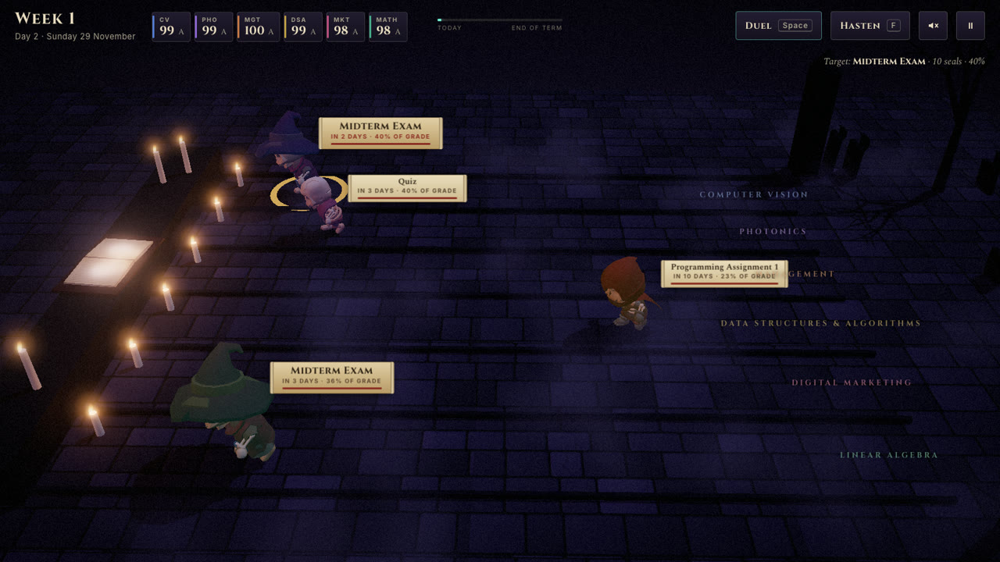
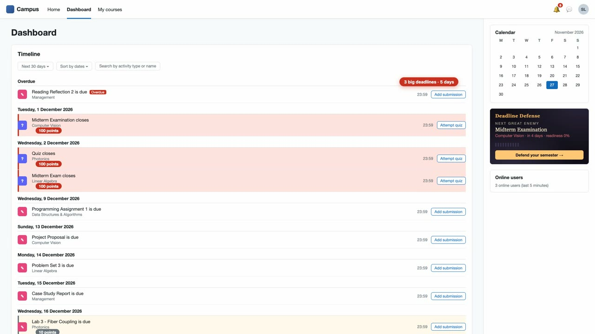
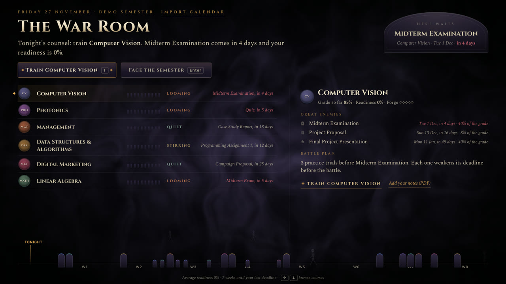
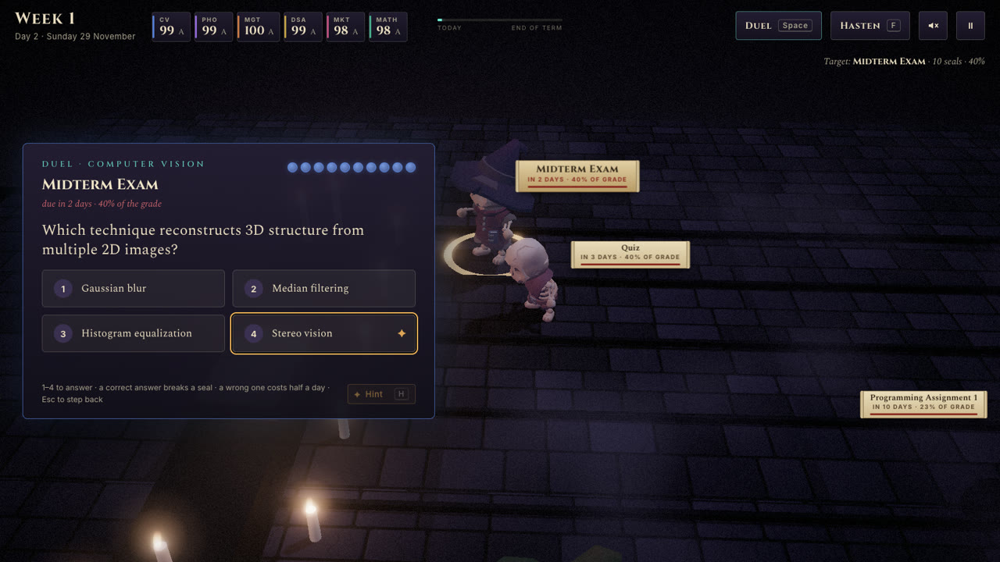
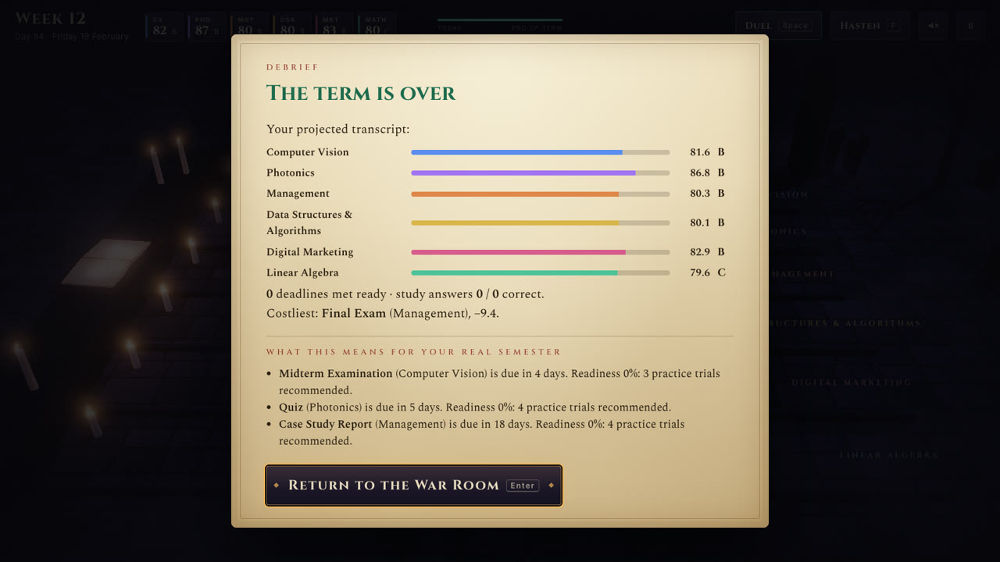
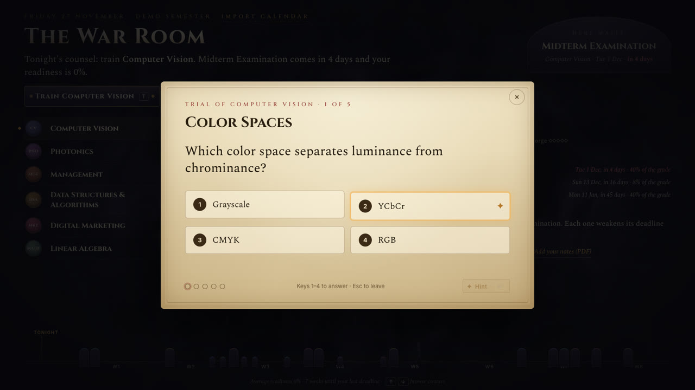

# Deadline Defense

**Your LMS tells you what is due. This shows you what matters.**

A haunted study tool in costume. Your real deadlines crawl out of the fog in the order they are due, each one as dangerous as its weight in your grade. The only weapon that works is studying.



*Kiroween 2026 · Costume Contest.* Built with **Kiro**: spec-driven development, steering, hooks, a custom agent, and 31 headless Kiro runs whose prompts live in [`.kiro/runs/`](.kiro/runs). See **[KIRO_USAGE.md](KIRO_USAGE.md)**.

**Play:** https://aywinu.github.io/GradeDefense/ · **LMS showcase (the Moodle block):** https://aywinu.github.io/GradeDefense/showcase/lms.html

---

## The problem
Every learning platform shows deadlines the same way: a grey list, the same little icon for every item. A 10-point lab and a 100-point midterm look identical. Three big ones can land in the same week, and nothing tells you where your next hour of study should go. So students study whatever is due next, not what weighs most, and find out at the end of term.

## Who it's for
- **University students** with several courses, weighted assessments and a calendar in Moodle (or any LMS that exports `.ics`). It is designed to be opened for ten minutes in the evening: it tells you what to do tonight, and lets you practise it right away.
- **Teachers and LMS admins**, who can add it to a course page as a **Moodle block**: no accounts, no server, no student data leaves the page.

## What it does
**1. It hides inside your LMS.** A small block in the side drawer shows your most dangerous deadline, and marks the deadlines that actually weigh on your grade. Open it, and the fog swallows the portal.



**2. The War Room tells you what to do tonight.** One line of *counsel*, based on due dates, weights and how ready you are. Each course shows its readiness (candles), its threat and its next big deadline. Select a course for its battle plan: real dates and points, how many practice trials to do before each, and the topics you keep missing.



**3. Practice trials** are five questions from one course. Correct answers raise readiness and **weaken that course's deadlines before the battle**. Wrong answers cost nothing and show the explanation; questions you missed come back first. No questions for your course? **Drop in your lecture notes (PDF)** and they become questions, locally in your browser.

**4. The procession: the battlefield is your calendar.** Each real deadline is a rigged, animated skeleton; its distance from the altar is its days left, and the altar is today. Exams are mages, projects armoured warriors, assignments rogues, quizzes minions, tinted by course and labelled with their **share of the grade**.
- **You choose what to fight** and duel it with **questions from its own course**. A correct answer breaks a seal (three in a row break two). A wrong answer costs half a day: the whole calendar lurches forward.
- **When a deadline arrives, every seal still on it costs grade in that course, by its weight.** A 10-point lab barely scratches; a 100-point exam can fail the course. Your projected grade per course is always on screen.
- When an exam is a day away, time stops for a timed **last stand** question.



**5. Your projected transcript.** The term ends with a grade per course and concrete advice ("Quiz in 5 days, readiness 0%: 4 practice trials recommended").



**Your real semester:** import a calendar export (`.ics`, e.g. Moodle → Calendar → Export), parsed entirely in the browser, or install the **Moodle block** ([`moodle/block_gradedefense`](moodle/block_gradedefense), see [docs/moodle-integration.md](docs/moodle-integration.md)), which sends upcoming deadlines to the game with `postMessage`, with origin checks both ways and no tokens. Without either, a demo semester of six courses is loaded.

## For judges: try it in two minutes
1. Open https://aywinu.github.io/GradeDefense/ and press **Enter the War Room** (the demo semester loads by itself).
2. Select a course and press **Train** for a practice trial, or go straight to **Face the semester**.
3. On the battlefield, click a creature (or press **Space**) to duel it.

**The Hint button.** You don't know the answers to our Computer Vision or Photonics questions, and that's fine. Every question card (trials, duels and last stands) has a **Hint** button (or press **H**) that lights up the correct answer. It exists so you can see what the game does when a student *does* know the material: seals breaking, combos, a creature collapsing, a course grade that holds, and a passing transcript. Answer some wrong on purpose to see the other side: the calendar lurches forward and unprepared deadlines take grade. Hints are free and change nothing else; for a real student they work as a "show me" when stuck, and the explanation after each answer still teaches why.



## Accessibility
- Fully keyboard playable (Tab, Space, 1–4, H, P, M, T, arrows, Enter, Esc) with visible focus rings.
- `prefers-reduced-motion` is respected, and there's a toggle in the pause menu: no shake, flicker or fog drift, and minimal particles.
- Last-stand questions get double time ("extra time") with reduced motion on.
- Every sound has a caption; there's a mute toggle; text meets WCAG AA contrast.
- It works with storage blocked: the save module falls back to memory.

## Run it
```bash
npm install
npm run dev          # http://localhost:3000
npm test             # Vitest unit + property tests (fast-check)
npm run test:e2e     # Playwright smoke tests (builds and serves the app)
npm run build        # static site in dist/ (BASE_PATH=/GradeDefense/ for GitHub Pages)
```

## How it's built
```
.kiro/                 steering, spec (requirements → design → tasks), hooks, custom agent, run prompts
src/core/              pure game rules, no rendering: the procession (calendar clock, arrivals,
                       weighted grades), duels, QTE, readiness, scoring (+ unit and property tests)
src/game3d/            Three.js battlefield, rigged animated skeletons (KayKit, CC0)
src/game/              Phaser 4 scenes (title, War Room, battle orchestration)
src/ui/                DOM overlays: HUD, trials, duel and last-stand cards, hints, guided tours
src/study/model.ts     one source of truth for readiness, threat and advice across screens
src/import/            .ics parser and the embedded postMessage contract
moodle/                Moodle 4.5 block plugin
showcase/lms.html      generic LMS page embedding the block (used in the demo video)
```
The rules are pure functions with property-based tests. A headless simulation plays the whole demo semester to prove the design's claims (`src/core/procession.balance.test.ts`): **a student who never answers fails; one who answers at 75% accuracy passes everything; and prioritising by weight beats fighting whatever is nearest**.

## Disclosure
The demo semester (`src/data/demo.json`) uses synthetic course names and deadlines from an earlier project of ours; no code was reused and there are no real students. Everything else was built during the Kiroween submission period. [KIRO_USAGE.md](KIRO_USAGE.md) records who did what: Kiro, Claude Code, or the author. Moodle is a trademark of Moodle Pty Ltd; this project is not affiliated with it.

## Licence
MIT. Fonts are OFL, the skeleton characters are CC0 (KayKit by Kay Lousberg), and everything else, art and sound, is generated in code. See [CREDITS.md](CREDITS.md).
